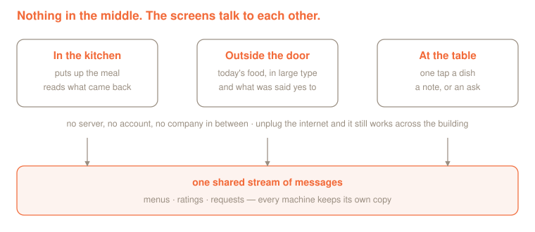

# Jeemo

*Jeemo* — from *jeeman*, Rajasthani for eating together as a community. The word
itself is an invitation: **eat**.

A place where people eat together three times a day already has everything it
needs to be interesting. Someone is cooking with care. Someone else grew the
millet. Somebody at the table has never eaten ragi in their life and is about
to. What is usually missing is any way for those facts to reach each other.

Jeemo is a small piece of software for that gap. The kitchen puts up each meal
with what is in it and how it was made. People eating see it before they arrive,
say what they thought one dish at a time, and ask for what they would like next.
The kitchen finally gets to see which dishes people actually want again.

It was built at the Logos and Zu-Grama Field Station in Rajasthan, India, where
twenty-odd people ate together for nine days, and every gap below showed up by
the second meal.



## What is missing when a group eats together

Not complaints. Just things nobody has built, so everyone works around them.

**You arrive at the food instead of meeting it.** There is no menu, or one
pinned where half the house never walks past, so lunch is a surprise every day.
Knowing what is coming changes how you turn up to it.

**The cooking is invisible.** Somebody soaked the lentils last night, somebody
chose millet over wheat, somebody's grandmother's proportions are in the pot.
None of that reaches the plate. You eat the result and learn nothing.

**Only the loudest opinion is heard.** One person says the dal was too salty and
that becomes the view of the room. The eleven people who loved it said nothing,
because there was nowhere to say it.

**Asking takes nerve.** More curd, less chilli, something without onion. Each is
a small ask and each requires finding the right person and interrupting them, so
most people just don't.

**Nobody hears back.** You ask once, nothing visibly happens, and you quietly
stop asking. The kitchen may well have done it; you never found out.

**And the kitchen cooks blind.** Months of meals and no record of which dishes
landed. The cook is the person with the most to gain from knowing, and the
person who knows least.

## What Jeemo does about it

### You meet the food before you eat it

A screen outside the dining room shows today's meals in type you can read while
walking past. Under each dish: what went into it, and how it was made. Not a
label, a short account.

This is the part that turns out to matter most. Once what is in the pot is
written down, a meal stops being something handed to you and starts being
something you know about. People find out what ragi is. Somebody discovers they
have been eating drumstick for a week. Somebody with a nut allergy stops having
to ask every time. The cook's work becomes visible for the first time.

### Saying what you thought takes one tap

At the table, each dish gets three buttons: *more please*, *fine*, *not for me*.
That is the whole interaction for most people. If you want to say more, there is
a box, and what you write travels attached to your rating, so the kitchen can
tell praise from complaint without guessing.

Then you hand the tablet to the next person and it forgets you completely.

### Asking becomes normal

*Ask about this dish* sits under every dish, and *ask about this meal* under
every meal, so a request arrives with its context attached. "Less chilli" means
nothing; "less chilli in the sambhar" is something a cook can act on tomorrow.

When the kitchen says yes, it appears on the board outside. The person who asked
finds out by walking past, and everyone else learns that asking works. That
second part is what makes the feature get used at all.

### The kitchen gets a memory

Each dish keeps its history. Cook it again and it comes back with its past
attached: how often it has been made, how it scored, what people wrote. Over a
week the kitchen can see what is worth repeating and what quietly nobody
finishes.

That record is also the most practical sustainability lever in a kitchen this
size. Food is wasted mostly by cooking things people do not eat, and until now
nobody had any way of knowing which those were.

## What it is like to run

**No server, no account, no company in between.** The machines pass messages to
each other directly and each keeps its own copy. Nothing to host, nothing to
pay for monthly, nobody who owns the data. Unplug the internet and it keeps
working across the building, which matters more in rural Rajasthan than in a
product meeting.

**Nothing is traceable to you.** A rating carries no identity at all, and the
one-time tag on it is thrown away the moment the tablet is handed on. Requests
carry no name either. That rule lives in the networking layer rather than in the
screens, so a screen written later cannot quietly break it.

**You cannot be singled out.** A dish's breakdown stays hidden until three
people have answered it. In a group of twenty, one visible complaint is an
identified complainer, and then nobody complains again.

**The history stays honest.** A dish's ratings belong to its name. Bring a dish
back and it returns exactly as it was; change the recipe and it has to take a
new name. Last month's scores never quietly come to mean something else.

## Where this goes next

Honest about the state of it: this is a working pilot, not a finished product.

**The look is bounded by where it runs.** Jeemo lives inside Logos Basecamp, and
Basecamp's module system decides what a screen can be. Everything here is drawn
by hand in QML inside that frame. It works, and it is plainly a developer tool
rather than something designed for a kitchen wall.

Two ways out, and they are not exclusive:

- **Basecamp itself improves.** It is young and moving. As its interface layer
  grows, modules like this one inherit that for free.
- **An ordinary front end over the same core.** Everything that matters in Jeemo
  lives in one small networking piece with four methods. A normal web-style
  interface could sit on top of it, bundled as an app you double click, with the
  decentralised half unchanged underneath. The person using it would never need
  to know what Basecamp is.

Also not built yet, in the order I would do them: **photographs** of dishes,
which need Codex and are most of what makes a food app worth looking at;
**allergen and diet marks**, which the data model already has room for;
**portions left**, one tap from the kitchen onto the board outside; and a
**weekly sheet** for the cook, which is a view of data already collected rather
than a new feature.

---

The rest of this document is for whoever is going to build on it: how the pieces
fit together, what travels between them, and how to compile and install it.

## How it is built

Built on the pattern from
[logos-shared-color](https://github.com/hackyguru/logos-shared-color):
one `core` module in C++ that owns the delivery node, and `ui_qml` modules
that call into it through `logos.callModule`. UI modules are sandboxed away
from the network in Basecamp, so this split is not a style choice.

The core is written in the **universal** authoring model, which the module
builder now requires of any core module shipping a plugin. That means
`src/jeemo_net_impl.h` is the entire contract: its public methods are the
module's API, and the Qt plugin, the `.lidl`, the C-ABI wrapper and the event
glue are all generated from it. There is no hand-written interface or plugin
pair, and no Qt in the module's own code.

The shared-color tutorial predates this and still uses the older hand-written
path, so its `metadata.json` has no `interface` field. Copying it verbatim
today fails at evaluation with a message naming exactly that.

## What this actually uses

| Logos pillar | Module | Used? |
| --- | --- | --- |
| Messaging | `delivery_module` | yes, for every menu, rating and request |
| Storage | Codex | no |
| Blockchain | Nomos | no |

History is a plain JSON-lines file written by `jeemo_net` to
`~/.local/share/jeemo/state.jsonl`, one message per line, or wherever
`JEEMO_STORE` points. It exists only so a machine that was switched off does
not come back blank, because messaging delivers what is published while you
are listening and is not a database. Moving it to Codex is the first thing to
do if history should be shared between machines rather than merely survive a
restart on one, and it is the same change that would carry dish photographs.

## The four modules

| Module | Type | Runs where |
| --- | --- | --- |
| `jeemo_net` | core | every machine. All the networking and all the state. |
| `jeemo_chef_ui` | ui_qml | the chef or manager. Put up meals, read what came back. |
| `jeemo_board_ui` | ui_qml | the screen outside the dining room. Read only. |
| `jeemo_guest_ui` | ui_qml | a resident's own Basecamp, or the tablet on the table. |

Install `jeemo_net` first on every machine, then whichever screens that
machine needs. A machine may carry more than one.

## How it moves

```
          /jeemo/1/menu/json                /jeemo/1/rating/json
  chef  ──────────────────────▶  everyone     everyone ◀────────────  guest
  board ◀──────────────────────               chef    ◀────────────
```

Two content topics, named per LIP-23. Everyone subscribes to both; what a
screen does with them is the only difference between the three UIs.

`jeemo_net` holds the merged state and settles conflicts the same way on
every machine, so the three screens agree without talking to each other
directly:

- **Menus: last write wins per `menuId`**, which is `<day>-<meal>`. Re-posting
  dinner replaces dinner everywhere. Ties on timestamp break by sender id, so
  every peer picks the same winner.
- **Ratings: last write wins per `nonce`.** One answer per person per dish.
  A later message under the same nonce is that person changing their mind or
  adding a note, not a second vote.
- **`itemId` is a slug of the dish name**, stable across days. That is what
  makes "cooked four times, liked three" possible with no central id service.

## Privacy, and why it is in the core

The `nonce` on a rating is a random string generated for whoever is holding
the tablet, joined to the dish's id so that one person's answers to different
dishes stay separate: `k7f3a91c2-laal-maas`. The random half is thrown away
when the tablet is handed on, so nothing links one visitor's answers to the
next one's. It exists so duplicates can be dropped, nothing more, and it must
never be derived from a device id, a key, or anything that survives a reset.

`publishRating` in the core deliberately does **not** attach the sender id,
though `publishMenu` does. A menu is a public act by the cooks; a rating is
not. Putting this in the core rather than in each UI means a new screen cannot
get it wrong later.

The chef UI holds back a dish's breakdown until three people have answered it.
In a group of twenty, one visible critic is an identified critic.

## Reviews carry their rating

A written note travels inside the same message as that person's rating, so
the chef screen shows them together: each note is labelled *wanted more*,
*said it was fine*, or *not for them*, in the colour of that verdict.

Without it the notes mislead. "Too much chilli" from someone who wanted more
of the dish is praise; the same four words from someone who left it are not,
and the words alone cannot tell you which.

## Messages

```json
{
  "v": 1, "type": "menu",
  "menuId": "2026-10-25-dinner",
  "day": "2026-10-25", "meal": "dinner",
  "note": "At the fire, from 8",
  "items": [
    { "itemId": "laal-maas", "name": "Laal Maas",
      "description": "Mutton in Mathania chillies and yoghurt.",
      "tags": ["non-veg", "spicy"] }
  ],
  "at": 1792840000
}
```

```json
{
  "v": 1, "type": "rating",
  "menuId": "2026-10-25-dinner",
  "itemId": "laal-maas",
  "score": 2,
  "comment": "More of this please",
  "nonce": "k7f3a91c2-laal-maas",
  "at": 1792841000
}
```

`score` is 2 wanted more, 1 fine, 0 did not like it.

## What the core exposes

Everything returns a value or a JSON string; `Link.qml` normalises both.

| Method | Does |
| --- | --- |
| `startDelivery()` / `stopDelivery()` | node lifecycle |
| `deliveryStatus()` | 0 off, 1 connecting, 2 connected, 3 error |
| `publishMenu(json)` / `publishRating(json)` | send one message |
| `menus()` / `ratings()` | the merged state, as JSON arrays |
| `revision()` | one integer that moves on any change |
| `peerInfo()` | role and ports, for wiring the next machine |
| `clearAll()` | wipe local state. Demos only. |

The UIs poll `revision()` once a second and only pull the lists when it moves,
so an idle board costs one small call per second rather than two full reads.

## Sidebar icons

Each UI module carries its own, named in its `metadata.json`:

```json
"icon": "icons/chef.png"
```

The file is a 128x128 PNG inside the module, and the name is what Basecamp
shows in the sidebar next to it. Change either and rebuild that module; the
icon is baked into the `.lgx` at build time, so editing the PNG in an
installed plugin folder does nothing.

A module installed by hand rather than built refers to its icon from
`manifest.json` instead, usually as `assets/icon.png`.

## The core's files

```
jeemo-core/
  metadata.json          "interface": "universal", depends on delivery_module
  CMakeLists.txt
  src/jeemo_net_impl.h   the whole API. Public methods are the contract.
  src/jeemo_net_impl.cpp merge rules, delivery calls, local history
  src/jeemo_json.h       a 120-line reader for the six top-level fields
```

`jeemo_json.h` exists because module code in this model is Qt-free, and the
core only ever reads `type`, `v`, `menuId`, `nonce`, `at` and `from` off the
top level of a message. It never walks into the items array; that is the UI's
business. Messages are stored and re-sent byte for byte as they arrived, so a
field added by a newer UI survives a hop through an older core untouched.

## Build

Nix with flakes. The first build pulls the whole `logos-delivery-module`
closure, so allow 15 to 30 minutes. Later builds take seconds.

```bash
cd jeemo-core
nix flake update                                  # first time only
nix build '.#lgx-portable' --out-link result-portable

cd ../jeemo-chef-ui
nix build --override-input jeemo_net path:../jeemo-core \
  '.#lgx-portable' --out-link result-portable

cd ../jeemo-board-ui
nix build --override-input jeemo_net path:../jeemo-core \
  '.#lgx-portable' --out-link result-portable

cd ../jeemo-guest-ui
nix build --override-input jeemo_net path:../jeemo-core \
  '.#lgx-portable' --out-link result-portable
```

Each build leaves an `.lgx` at `result-portable/*.lgx`. In Basecamp, open
**Modules → Install LGX Package**. Install `jeemo_net` first, then the UI.
`delivery_module` is already in Basecamp.

## Running it on more than one machine

Each node needs its own ports and its own key. Everything that varies per
machine is an environment variable, so no machine needs a different build.

```
JEEMO_ROLE      chef | board | guest   picks sane defaults for ports and key
JEEMO_TCPPORT   override the TCP port
JEEMO_UDPPORT   override the discv5 UDP port
JEEMO_NODEKEY   32-byte hex libp2p key
JEEMO_PEERS     comma-separated multiaddrs to dial directly
```

### Two instances on one machine, to try it

```bash
JEEMO_ROLE=chef  ./LogosBasecamp &
JEEMO_ROLE=guest ./LogosBasecamp &
```

The chef defaults to TCP 60000 and the guest to 60001, and each lists the
other in `staticNodes` over loopback, so they find each other without
depending on any bootstrap fleet.

Kill leftovers between runs, or a stale host holds the old libraries:

```bash
pkill -9 -f LogosBasecamp; pkill -9 -f logos_host
```

### Three machines on one network

The bundled `logos.dev` bootstrap peer IDs have been stale upstream, which is
why the shared-color tutorial pins static nodes rather than trusting
discovery. Do the same here: start one machine, read its PeerID out of the
Basecamp log, and list it on the others.

```bash
# on the chef's laptop, at 192.168.1.10
JEEMO_ROLE=chef ./LogosBasecamp

# on the board and on each resident's machine
JEEMO_ROLE=board \
JEEMO_PEERS=/ip4/192.168.1.10/tcp/60000/p2p/<chef PeerID> \
  ./LogosBasecamp
```

Every peer reaching the chef's machine is enough; gossipsub relays the rest.

## Why history is stored locally

Messaging delivers what is published while you are listening. It is not a
database. A laptop switched off overnight would come back blank, so
`jeemo_net` mirrors its merged state to one JSON file under the application
data directory and reloads it on start.

Codex is the right home for this the moment history needs to be shared
between machines rather than merely survive a restart on one, and it is also
the answer for dish photographs, which are far too large to put inside a
message. Neither is wired up here.

## Known limits

See "Where this goes next" above for the product-level gaps. The engineering
ones:

- **Photographs.** The data model has room for them. They belong in Codex with
  only the reference travelling in the message.
- **Shared history.** A machine that was never switched on sees only what is
  published from then onwards.
- **Rating windows are enforced in the UI**, not in the core. A hostile peer
  could post a rating at any hour. That is the right trade for a residency
  dining room and the wrong one for anything larger.
